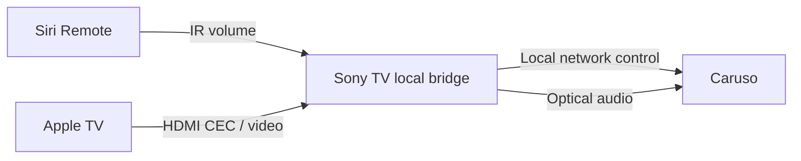

# Caruso TV Bridge

[English](README.md) · [Deutsch](README.de.md) · [Italiano](README.it.md) · [Français](README.fr.md) · [日本語](README.ja.md) · [繁體中文](README.zh-TW.md)

**Copyright (c) 2026 Adms Chung** · [Apache-2.0](LICENSE) · [Urheber- und Quellenangaben](docs/ATTRIBUTION.md)

**Desktop-Quellstand 0.5.31:** Apple-TV-Musiksteuerung und Metadaten, USB-Stummschaltung, synchronisierte Liedtexte und dekoratives Zen Sand sind enthalten. Die Einrichtung verwendet private lokale Dateien: [Desktop-Anleitung](docs/WEB.md), [Datenschutz bei der Veröffentlichung](docs/PUBLICATION.md).

Eine lokale Web-/macOS-Fernbedienung für **T+A Caruso** und eine experimentelle **Sony-Android-TV-Bridge für die Siri Remote**. Die optische Audioverbindung bleibt erhalten: Die Siri Remote steuert die Caruso-Lautstärke, und die Bridge folgt dem Standby- und Aufwachverhalten des Fernsehers. Sie läuft direkt auf dem Fernseher; für den täglichen Bridge-Betrieb muss kein Mac eingeschaltet bleiben.

**In der öffentlichen Version ist keine IP-Adresse des Audiogeräts voreingestellt.** Konfigurieren Sie Ihre Geräte ausschließlich lokal. Diese Übersetzungen betreffen die README-Dateien; die App-Oberfläche ist derzeit überwiegend auf traditionellem Chinesisch. Die verlinkten technischen Anleitungen sind hauptsächlich auf Englisch.

## Funktionen

| Komponente | Funktion | Aktuelle Einschränkungen |
| --- | --- | --- |
| Sony-TV-Bridge | Empfangene IR-Lautstärketasten ± → Caruso; TV-Standby → Comfort-Standby; Apple-TV-Aufwachen / konfiguriertes HDMI Active Source → Einschalten und optischer Eingang | Erfordert lokales ADB auf dem TV sowie kompatibles IR-/HDMI-CEC-Verhalten; Modell und Firmware müssen geprüft werden |
| Web / Electron | LUCI-Medienstatus, Lautstärke- und Wiedergabesteuerung; schreibgeschützte Seite für Klangeinstellungen | Vollständige Klangeinstellungen lassen sich noch nicht auslesen; vollständige Sicherung und Wiederherstellung bleiben deaktiviert |

Wiedergabe/Pause auf der Siri Remote behält die normale Apple-TV-Funktion. Im Referenzaufbau war diese Taste auf Sony-Seite nicht erkennbar. Deshalb folgt die Wahl des optischen Eingangs dem Aufwachen bzw. HDMI Active Source. Ob ein Wechsel des TV-Eingangs dieses CEC-Ereignis auslöst, hängt vom Gerät ab.

Die Lautstärkeskalen unterscheiden sich: Die TV-Bridge verwendet die native MCU-Skala **0–63**, der Web-Controller LUCI **0–100**. Die einzelnen Stufen sind nicht direkt gleichzusetzen.

## Schnellstart: Web / macOS

Benötigt Node.js 22+; die Electron-Abhängigkeiten setzen mindestens 22.12 voraus. Klonen Sie das Repository und wechseln Sie in das Web-Verzeichnis:

```sh
git clone https://github.com/adms/caruso-tv-bridge.git
cd caruso-tv-bridge/web
```

`10.0.0.123` ist unten eine **fiktive Beispieladresse**. Ersetzen Sie sie durch die private IPv4-Adresse Ihres Caruso und starten Sie den Browser-Controller:

```sh
CARUSO_HOST=10.0.0.123 npm start
```

Öffnen Sie <http://127.0.0.1:43186>. Der Dienst lauscht ausschließlich auf der lokalen Loopback-Adresse und bietet keine Fernsteuerung über das Internet. Ohne `CARUSO_HOST` wird der Start abgebrochen; es gibt weder einen automatischen Netzwerkscan noch ein voreingestelltes Ersatzgerät.

Für die Electron-Desktop-App führen Sie die folgenden Befehle im selben Verzeichnis `web/` aus. Beenden Sie zuvor den Browser-Controller, falls er noch läuft:

```sh
npm ci
CARUSO_HOST=10.0.0.123 npm run desktop
npm run package:mac
npm run sign:mac:adhoc
```

Das Paketierungsskript erstellt eine App für **Apple Silicon macOS (arm64)** in `web/dist/`. Der obige Befehl signiert lokal ad hoc. Für Developer ID verwenden Sie Ihre eigene `CARUSO_MAC_SIGN_IDENTITY` mit `npm run sign:mac`; die Notarisierung erfolgt separat. Der Start verwendet `CARUSO_HOST` oder eine private `devices.json`: [Web-/macOS-Anleitung](docs/WEB.md).

## Einrichtung auf Sony Android TV

Folgen Sie der [Android-Build- und Installationsanleitung](docs/ANDROID.md). Stellen Sie in der App vor dem Start der Bridge die Caruso-IP, den Apple-TV-HDMI-Port, die logische CEC-Adresse sowie Pfad und Namen des IR-Geräts ein. Die erste lokale ADB-Autorisierung muss am Fernseher bestätigt werden.



Der Fernseher muss lokale ADB-Verbindungen zu `127.0.0.1:5555` zulassen. Die Bridge nutzt die normale Android-Autorisierung, benötigt keinen Root-Zugriff und umgeht keine Systembestätigung. Nicht jedes Android-TV-Gerät und jede Firmware unterstützen dieses Verhalten.

## Validierung und Einschränkungen

Der Prototyp wurde mit einer physischen Fernbedienung auf **einer Sony-Android-TV-/Caruso-Kombination** hinsichtlich Lautstärke und Ein-/Ausschalten getestet. Dabei war die ADB-Verbindung des Mac getrennt. **Die öffentliche Version v0.3.0 ergänzt konfigurierbare Gerätefelder und hat Tests mit simulierten Geräten sowie APK-Builds bestanden; daraus folgt keine allgemeine Hardwarekompatibilität.**

Ist der optische Eingang bereits aktiv, wird der Auswahlbefehl nicht erneut gesendet. Der Wechsel von einer anderen Quelle zum optischen Eingang und der automatische Start nach einem vollständigen TV-Neustart müssen noch auf Ihren eigenen Geräten geprüft werden. Weitere Einzelheiten: [Validierung](docs/VALIDATION.md).

Es gibt keine Schreibfunktionen für EQ, Klangfeld oder Lautsprecheraufstellung. Exportierte Beobachtungen sind Statusaufzeichnungen und **keine wiederherstellbaren Einstellungssicherungen**. Laufzeitprotokolle und exportierte Beobachtungen können die Geräte-IP und Medieninformationen enthalten; entfernen Sie diese vor dem Teilen.

## Entwicklung

Im Stammverzeichnis des Repositorys ausführen:

```sh
node --test web/test/*.test.mjs
python3 scripts/test_bridge.py
python3 -m unittest discover -s scripts/tests
python3 scripts/check_public_tree.py --history
```

Die Tests verwenden lokale simulierte Dienste und benötigen kein Audiogerät. Android-Builds benötigen JDK 17+, Python 3.9+ und ein Android SDK. CI führt Tests, Datenschutzprüfungen des Quellbaums und einen unsignierten APK-Build aus; Verbindungen zu privaten Geräten werden nicht hergestellt.

## Lizenz, Urheberangaben und Beiträge

Sofern nicht als Drittmaterial gekennzeichnet, stehen eigener Code, Skripte, Dokumentation und Diagramme unter der **Apache License 2.0**. Bei Weitergabe sind die Lizenz sowie die jeweils einschlägigen Urheber- und [NOTICE](NOTICE)-Angaben beizubehalten; geänderte Dateien müssen gemäß Lizenz mit Änderungshinweisen versehen sein. Die Angaben umfassen **Copyright (c) 2026 Adms Chung** und die [Projektquelle](https://github.com/adms/caruso-tv-bridge).

Die [Hinweise zu Urheber- und Quellenangaben (Traditionelles Chinesisch)](docs/ATTRIBUTION.md) erläutern Zitierempfehlungen und die frühere MIT-Lizenzierung. Zitiermetadaten stehen in [CITATION.cff](CITATION.cff), die Lizenzbedingungen für Beiträge in [CONTRIBUTING](CONTRIBUTING.md). NOTICE und Zitierempfehlungen ergänzen Apache-2.0 nicht um zusätzliche Bedingungen.

Drittanbieterkomponenten behalten ihre Urheberangaben und Lizenzen; siehe [THIRD_PARTY_NOTICES](THIRD_PARTY_NOTICES.md). Dieses unabhängige Kompatibilitätsprojekt ist weder mit T+A, Apple oder Sony verbunden noch von ihnen unterstützt oder empfohlen.
