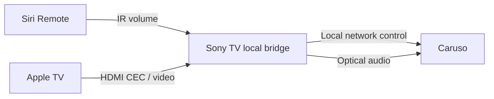

# Caruso TV Bridge

[English](README.md) · [Deutsch](README.de.md) · [Italiano](README.it.md) · [Français](README.fr.md) · [日本語](README.ja.md) · [繁體中文](README.zh-TW.md)

**Copyright (c) 2026 Adms Chung** · [Apache-2.0](LICENSE) · [Attribution](docs/ATTRIBUTION.md)

Une télécommande locale web/macOS pour **T+A Caruso**, accompagnée d'une **passerelle expérimentale pour Siri Remote sur Sony Android TV**. Conservez votre liaison audio optique, réglez le volume du Caruso avec Siri Remote et suivez la mise en veille et le réveil du téléviseur. La passerelle fonctionne directement sur le téléviseur : aucun Mac n'a besoin de rester allumé pour son usage quotidien.

**Aucune adresse IP du système audio n'est prédéfinie dans la version publique.** Configurez vos appareils uniquement dans votre environnement local. Ces traductions concernent les README ; l'interface de l'application est actuellement principalement en chinois traditionnel. Les guides techniques liés sont surtout en anglais.

## Fonctionnalités

| Composant | Fonctionnement | Limites actuelles |
| --- | --- | --- |
| Passerelle Sony TV | Commandes IR de volume ± reçues → Caruso ; veille du TV → veille Comfort ; réveil d'Apple TV / HDMI Active Source configuré → allumage et entrée optique | Nécessite ADB en local sur le TV et un comportement IR/HDMI-CEC compatible ; chaque modèle et micrologiciel doit être vérifié |
| Web / Electron | État multimédia, volume et commandes de lecture via LUCI ; page des réglages sonores en lecture seule | Les réglages sonores complets ne sont pas encore accessibles ; sauvegarde complète et restauration restent désactivées |

La touche lecture/pause de Siri Remote conserve sa fonction habituelle sur Apple TV. Dans la configuration de référence, aucun événement correspondant à cette touche n'était observable côté Sony ; la sélection de l'entrée optique suit donc le réveil / HDMI Active Source. L'émission de cet événement CEC lors d'un changement d'entrée du téléviseur dépend de l'appareil.

Les échelles de volume diffèrent : la passerelle TV utilise l'échelle MCU native **0–63**, tandis que le contrôleur web utilise LUCI **0–100**. Leurs graduations ne sont pas directement équivalentes.

## Démarrage rapide : web / macOS

Nécessite Node.js 22+ ; les dépendances Electron exigent au minimum la version 22.12. Clonez le dépôt et ouvrez le répertoire web :

```sh
git clone https://github.com/adms/caruso-tv-bridge.git
cd caruso-tv-bridge/web
```

L'adresse `10.0.0.123` ci-dessous est un **exemple fictif**. Remplacez-la par l'adresse IPv4 privée de votre Caruso, puis démarrez le contrôleur pour navigateur :

```sh
CARUSO_HOST=10.0.0.123 npm start
```

Ouvrez <http://127.0.0.1:43186>. Le service écoute uniquement sur l'interface de bouclage locale et ne permet pas le contrôle à distance par Internet. Sans `CARUSO_HOST`, le démarrage s'arrête ; aucun balayage automatique du réseau ni appareil de remplacement prédéfini n'est utilisé.

Pour l'application de bureau Electron, exécutez les commandes suivantes depuis le même répertoire `web/`. Arrêtez d'abord le contrôleur pour navigateur s'il est encore en cours d'exécution :

```sh
npm ci
CARUSO_HOST=10.0.0.123 npm run desktop
npm run package:mac
npm run sign:mac
```

Le script de création du paquet cible **macOS sur Apple Silicon (arm64)** et écrit dans `web/dist/`. La signature est locale et ad hoc, sans notarisation Apple Developer ID. L'application empaquetée exige également `CARUSO_HOST` ; consultez le [guide web / macOS](docs/WEB.md) pour la lancer.

## Configuration sur Sony Android TV

Suivez le [guide de compilation et d'installation Android](docs/ANDROID.md). Avant de démarrer la passerelle, renseignez dans l'application l'IP du Caruso, le port HDMI d'Apple TV, l'adresse logique CEC ainsi que le chemin et le nom du périphérique IR. La première autorisation ADB locale doit être confirmée sur le téléviseur.



Le téléviseur doit autoriser les connexions ADB locales à `127.0.0.1:5555`. La passerelle utilise la procédure d'autorisation normale d'Android, ne nécessite pas d'accès root et ne contourne pas la confirmation du système. Ce comportement n'est pas disponible sur tous les appareils Android TV ni sur toutes les versions de micrologiciel.

## Validation et limites

Le prototype a été testé avec une télécommande physique pour le volume et l'alimentation sur **une seule configuration Sony Android TV / Caruso**, avec la connexion ADB du Mac déconnectée pendant l'utilisation. **La version publique v0.3.0 ajoute des champs de configuration des appareils et a passé des tests avec appareils simulés ainsi que des compilations APK ; cela ne démontre pas la compatibilité matérielle avec toutes les installations.**

Si l'entrée optique est déjà sélectionnée, la passerelle ne renvoie pas la commande de sélection. Le passage d'une autre source à l'entrée optique et le démarrage automatique après un redémarrage complet du téléviseur restent à vérifier sur vos propres appareils. Consultez les [détails de validation](docs/VALIDATION.md).

Aucune commande ne permet de modifier l'égaliseur, le champ sonore ou les réglages de placement des enceintes. Les observations exportées sont des relevés d'état, **pas des sauvegardes de réglages restaurables**. Les journaux d'exécution et les observations exportées peuvent contenir l'IP de l'appareil et des informations multimédias ; retirez ces données avant de les partager.

## Développement

À exécuter depuis la racine du dépôt :

```sh
node --test web/test/*.test.mjs
python3 scripts/test_bridge.py
python3 scripts/check_public_tree.py
```

Les tests utilisent des services locaux simulés et ne nécessitent pas de système audio. Les compilations Android nécessitent JDK 17+, Python 3.9+ et un Android SDK. La CI exécute les tests, vérifie l'absence de données privées dans les sources et produit un APK non signé ; elle ne se connecte pas aux appareils domestiques.

## Licence, attribution et contributions

Sauf mention de contenu tiers, le code original, les scripts, la documentation et les schémas sont sous **Apache License 2.0**. Toute redistribution doit inclure la licence et conserver les mentions de copyright et d'attribution de [NOTICE](NOTICE) qui restent applicables ; les fichiers modifiés doivent comporter les avis de modification exigés par la licence. L'attribution comprend **Copyright (c) 2026 Adms Chung** et le [dépôt d'origine](https://github.com/adms/caruso-tv-bridge).

Le [guide d'attribution (en chinois traditionnel)](docs/ATTRIBUTION.md) contient les suggestions de citation et l'historique de l'ancienne licence MIT. Voir [CITATION.cff](CITATION.cff) pour les métadonnées de citation et [CONTRIBUTING](CONTRIBUTING.md) pour la licence des contributions. NOTICE et les suggestions de citation n'ajoutent aucune condition à Apache-2.0.

Les composants tiers conservent leurs auteurs et licences d'origine ; voir [THIRD_PARTY_NOTICES](THIRD_PARTY_NOTICES.md). Ce projet indépendant de compatibilité n'est ni affilié à T+A, Apple ou Sony, ni approuvé par ces entreprises.
