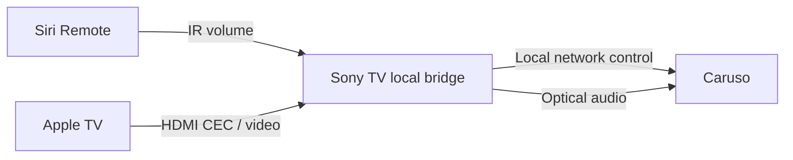

# Caruso TV Bridge

[English](README.md) · [Deutsch](README.de.md) · [Italiano](README.it.md) · [Français](README.fr.md) · [日本語](README.ja.md) · [繁體中文](README.zh-TW.md)

**Copyright (c) 2026 Adms Chung** · [Apache-2.0](LICENSE) · [Attribuzione](docs/ATTRIBUTION.md)

**Sorgenti desktop 0.5.31:** includono controllo e metadati musicali Apple TV, mute USB, testi sincronizzati e Zen Sand decorativo. La configurazione usa file locali privati: [guida desktop](docs/WEB.md), [privacy della pubblicazione](docs/PUBLICATION.md).

Un telecomando locale web/macOS per **T+A Caruso**, con un **bridge sperimentale per Siri Remote su Sony Android TV**. Mantieni il collegamento audio ottico, regola il volume del Caruso con Siri Remote e sincronizza il comportamento del sistema con lo standby e il risveglio del televisore. Il bridge viene eseguito sul televisore: per l'uso quotidiano non è necessario lasciare acceso un Mac.

**La versione pubblica non contiene un indirizzo IP preimpostato per il sistema audio.** Configura i tuoi dispositivi solo nell'ambiente locale. Queste traduzioni riguardano i README; l'interfaccia dell'app è attualmente soprattutto in cinese tradizionale. Le guide tecniche collegate sono principalmente in inglese.

## Funzionalità

| Componente | Funzioni | Limiti attuali |
| --- | --- | --- |
| Bridge per Sony TV | Comandi IR di volume ± ricevuti → Caruso; standby del TV → standby Comfort; risveglio di Apple TV / HDMI Active Source configurato → accensione e ingresso ottico | Richiede ADB locale sul TV e un comportamento IR/HDMI-CEC compatibile; ogni modello e firmware va verificato |
| Web / Electron | Stato dei contenuti multimediali, volume e riproduzione tramite LUCI; pagina delle impostazioni audio in sola lettura | Le impostazioni audio complete non sono ancora leggibili; backup completo e ripristino restano disabilitati |

Il tasto riproduzione/pausa di Siri Remote mantiene la normale funzione su Apple TV. Nella configurazione di riferimento, Sony non riceveva un evento osservabile per questo tasto; la selezione dell'ingresso ottico segue quindi il risveglio / HDMI Active Source. La generazione di questo evento CEC quando si cambia ingresso sul TV dipende dal dispositivo.

Le scale del volume sono diverse: il bridge TV usa la scala MCU nativa **0–63**, mentre il controller web usa LUCI **0–100**. I rispettivi incrementi non sono direttamente equivalenti.

## Avvio rapido: web / macOS

Serve Node.js 22+; le dipendenze Electron richiedono almeno la versione 22.12. Clona il repository e accedi alla directory web:

```sh
git clone https://github.com/adms/caruso-tv-bridge.git
cd caruso-tv-bridge/web
```

L'indirizzo `10.0.0.123` qui sotto è un **esempio fittizio**. Sostituiscilo con l'indirizzo IPv4 privato del tuo Caruso, quindi avvia il controller nel browser:

```sh
CARUSO_HOST=10.0.0.123 npm start
```

Apri <http://127.0.0.1:43186>. Il servizio ascolta solo sull'interfaccia loopback locale e non offre controllo remoto via Internet. Senza `CARUSO_HOST`, l'avvio si interrompe; non vengono eseguite scansioni automatiche della rete né selezionati dispositivi predefiniti.

Per l'app desktop Electron, esegui i seguenti comandi dalla stessa directory `web/`. Prima arresta il controller per browser, se è ancora in esecuzione:

```sh
npm ci
CARUSO_HOST=10.0.0.123 npm run desktop
npm run package:mac
npm run sign:mac:adhoc
```

Il pacchetto per **Apple Silicon macOS (arm64)** viene creato in `web/dist/`. Il comando sopra usa una firma ad hoc locale. Per Developer ID, usare la propria `CARUSO_MAC_SIGN_IDENTITY` con `npm run sign:mac`; la notarizzazione è separata. Avviare con `CARUSO_HOST` o un file privato `devices.json`: [guida web/macOS](docs/WEB.md).

## Configurazione su Sony Android TV

Segui la [guida alla compilazione e installazione Android](docs/ANDROID.md). Prima di avviare il bridge, imposta nell'app l'IP del Caruso, la porta HDMI di Apple TV, l'indirizzo logico CEC e il percorso/nome del dispositivo IR. La prima autorizzazione ADB locale deve essere confermata sul televisore.



Il televisore deve consentire connessioni ADB locali a `127.0.0.1:5555`. Il bridge usa la normale procedura di autorizzazione Android, non richiede root e non aggira la conferma del sistema. Non tutti i televisori Android TV o i firmware supportano questo comportamento.

## Verifiche e limiti

Il prototipo è stato provato con un telecomando fisico per volume e alimentazione su **una sola combinazione Sony Android TV / Caruso**, con la connessione ADB del Mac scollegata durante l'uso. **La versione pubblica v0.3.0 aggiunge campi configurabili per i dispositivi e ha superato test con dispositivi simulati e compilazioni APK; questo non dimostra la compatibilità hardware con ogni configurazione.**

Se l'ingresso ottico è già selezionato, il bridge non invia di nuovo il comando di selezione. Il passaggio da un'altra sorgente all'ingresso ottico e l'avvio automatico dopo un riavvio completo del TV richiedono ancora una verifica sui propri dispositivi. Consulta i [dettagli delle verifiche](docs/VALIDATION.md).

Non sono presenti comandi per modificare EQ, campo sonoro o impostazioni di posizionamento dei diffusori. Le osservazioni esportate sono registrazioni dello stato, **non backup ripristinabili delle impostazioni**. I log di esecuzione e le osservazioni esportate possono contenere l'IP del dispositivo e informazioni sui contenuti multimediali: rimuovi questi dati prima di condividerli.

## Sviluppo

Esegui dalla directory principale del repository:

```sh
node --test web/test/*.test.mjs
python3 scripts/test_bridge.py
python3 -m unittest discover -s scripts/tests
python3 scripts/check_public_tree.py --history
```

I test usano servizi locali simulati e non richiedono un sistema audio. Le compilazioni Android richiedono JDK 17+, Python 3.9+ e un Android SDK. La CI esegue test, controlli sui dati privati nel codice sorgente e una compilazione APK non firmata; non si collega ai dispositivi domestici.

## Licenza, attribuzione e contributi

Salvo i materiali identificati come di terze parti, codice originale, script, documentazione e diagrammi sono distribuiti con **Apache License 2.0**. La ridistribuzione deve includere la licenza e conservare gli avvisi di copyright e di attribuzione in [NOTICE](NOTICE) ancora applicabili; i file modificati devono riportare gli avvisi di modifica richiesti dalla licenza. L'attribuzione include **Copyright (c) 2026 Adms Chung** e il [repository di origine](https://github.com/adms/caruso-tv-bridge).

La [guida all'attribuzione (in cinese tradizionale)](docs/ATTRIBUTION.md) contiene suggerimenti per le citazioni e la cronologia della precedente licenza MIT. Consulta [CITATION.cff](CITATION.cff) per i metadati di citazione e [CONTRIBUTING](CONTRIBUTING.md) per la licenza dei contributi. NOTICE e i suggerimenti per le citazioni non aggiungono condizioni ad Apache-2.0.

I componenti di terze parti conservano autori e licenze originali: vedi [THIRD_PARTY_NOTICES](THIRD_PARTY_NOTICES.md). Questo progetto indipendente di compatibilità non è affiliato né approvato da T+A, Apple o Sony.
