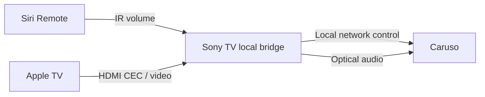

# Caruso TV Bridge

[English](README.md) · [Deutsch](README.de.md) · [Italiano](README.it.md) · [Français](README.fr.md) · [日本語](README.ja.md) · [繁體中文](README.zh-TW.md)

**Copyright (c) 2026 Adms Chung** · [Apache-2.0](LICENSE) · [著作権・出典表記](docs/ATTRIBUTION.md)

**T+A Caruso** を操作するローカル Web／macOS リモコンと、**Sony Android TV 上で動作する Siri Remote 用の実験的なブリッジ**です。光デジタル音声接続を維持したまま、Siri Remote で Caruso の音量を調整し、テレビの待機・復帰に連動させられます。ブリッジはテレビ本体で動作するため、日常的な連携のために Mac を起動しておく必要はありません。

**公開版にはオーディオ機器の IP アドレスを初期値として設定していません。** ご自身の機器情報をローカル環境で設定してください。今回の翻訳対象は README です。アプリの画面は現在、主に繁体字中国語で表示されます。リンク先の技術ガイドは主に英語です。

## 機能

| コンポーネント | 機能 | 現在の制約 |
| --- | --- | --- |
| Sony TV ブリッジ | 受信した赤外線の音量 ± → Caruso／テレビの待機 → Comfort 待機／Apple TV の復帰・設定した HDMI Active Source → 電源オンと光入力選択 | テレビ上のローカル ADB と対応する赤外線・HDMI-CEC の動作が必要。機種・ファームウェアごとの確認が必要 |
| Web / Electron | LUCI によるメディア状態表示、音量・再生操作、読み取り専用の音質設定ページ | 音質設定全体の読み取りには未対応。完全なバックアップと復元は無効のまま |

Siri Remote の再生／一時停止ボタンは、Apple TV 本来の動作を維持します。検証に使用した構成では、このボタンの信号を Sony 側で観測できなかったため、光入力の選択は復帰／HDMI Active Source に連動します。テレビの入力切り替え時にこの CEC イベントが発生するかどうかは、機器によって異なります。

音量の尺度は異なります。TV ブリッジは MCU のネイティブ値 **0–63**、Web コントローラーは LUCI の **0–100** を使用します。それぞれの 1 段階を同じ音量差として扱うことはできません。

## Web / macOS のクイックスタート

Node.js 22 以降が必要です。Electron の依存パッケージには少なくとも 22.12 が必要です。リポジトリをクローンし、web ディレクトリに移動します。

```sh
git clone https://github.com/adms/caruso-tv-bridge.git
cd caruso-tv-bridge/web
```

以下の `10.0.0.123` は **説明用の架空のアドレス**です。お使いの Caruso のプライベート IPv4 アドレスに置き換えて、ブラウザー用コントローラーを起動してください。

```sh
CARUSO_HOST=10.0.0.123 npm start
```

<http://127.0.0.1:43186> を開きます。サービスはローカルのループバックアドレスだけで待ち受け、インターネット経由の遠隔操作は提供しません。`CARUSO_HOST` が未設定の場合は起動を中止します。ネットワークの自動スキャンや既定の機器への接続は行いません。

Electron デスクトップアプリを使う場合は、同じ `web/` ディレクトリで以下を実行します。ブラウザー用コントローラーが動作中の場合は、先に停止してください。

```sh
npm ci
CARUSO_HOST=10.0.0.123 npm run desktop
npm run package:mac
npm run sign:mac
```

パッケージ作成スクリプトは **Apple Silicon 搭載 Mac（arm64）** を対象とし、`web/dist/` に出力します。署名はローカルの ad-hoc 署名で、Apple Developer ID による公証は行っていません。パッケージ版も `CARUSO_HOST` が必要です。起動方法は [Web / macOS ガイド](docs/WEB.md) を参照してください。

## Sony Android TV の設定

[Android のビルド・インストールガイド](docs/ANDROID.md) に従ってください。ブリッジを開始する前に、アプリで Caruso の IP、Apple TV の HDMI ポート、CEC 論理アドレス、赤外線デバイスのパスと名前を設定します。初回のローカル ADB 接続は、テレビ上で許可する必要があります。



テレビ側で `127.0.0.1:5555` へのローカル ADB 接続が許可されている必要があります。Android の通常の認証手順を利用し、root 権限は不要です。システムの確認画面を迂回することもありません。すべての Android TV やファームウェアがこの動作に対応しているわけではありません。

## 検証範囲と制約

試作版では、**1 組の Sony Android TV／Caruso 構成**で実物のリモコンを使い、音量と電源連携を検証しました。操作中は Mac の ADB 接続を切断していました。**公開版 v0.3.0 は機器設定項目を追加し、模擬デバイスによるテストと APK ビルドを通過していますが、すべての構成での実機互換性を確認したものではありません。**

すでに光入力が選択されている場合、入力選択コマンドは再送しません。別の音源から光入力への切り替えや、テレビの完全な再起動後の自動起動は、お使いの機器で別途確認が必要です。[検証の詳細](docs/VALIDATION.md) を参照してください。

EQ、音場、スピーカー設置位置の設定を書き換える操作はありません。エクスポートする観測データは状態の記録であり、**復元可能な設定バックアップではありません**。実行ログや観測データには機器の IP やメディア情報が含まれることがあるため、共有前に削除またはマスキングしてください。

## 開発

リポジトリのルートディレクトリで実行します。

```sh
node --test web/test/*.test.mjs
python3 scripts/test_bridge.py
python3 scripts/check_public_tree.py
```

テストはローカルの模擬サービスを使用するため、オーディオ機器は不要です。Android のビルドには JDK 17 以降、Python 3.9 以降、Android SDK が必要です。CI はテスト、ソース内の個人情報チェック、未署名 APK のビルドを実行します。家庭内の機器には接続しません。

## ライセンス・著作権表記・貢献

第三者の資料として明示されているものを除き、本プロジェクト独自のコード、スクリプト、文書、図は **Apache License 2.0** で提供します。再配布時はライセンスを添付し、適用される著作権表示と [NOTICE](NOTICE) の帰属表示を保持してください。変更したファイルには、ライセンスに従って変更した旨を明記する必要があります。表示には **Copyright (c) 2026 Adms Chung** と [プロジェクトの出典](https://github.com/adms/caruso-tv-bridge) を含みます。

推奨する引用形式と旧 MIT ライセンスの履歴は [著作権・出典表記ガイド（繁体字中国語）](docs/ATTRIBUTION.md)、引用メタデータは [CITATION.cff](CITATION.cff)、貢献時のライセンス条件は [CONTRIBUTING](CONTRIBUTING.md) を参照してください。NOTICE と引用の推奨形式は、Apache-2.0 に追加条件を課すものではありません。

第三者のコンポーネントは元の著作者表示とライセンスを保持します。[THIRD_PARTY_NOTICES](THIRD_PARTY_NOTICES.md) を参照してください。本プロジェクトは独立した互換性プロジェクトであり、T+A、Apple、Sony との提携関係や、これらの企業による承認を示すものではありません。
