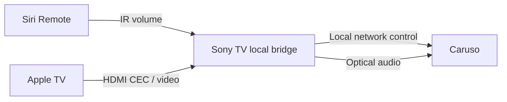

# Caruso TV Bridge

[English](README.md) · [Deutsch](README.de.md) · [Italiano](README.it.md) · [Français](README.fr.md) · [日本語](README.ja.md) · [繁體中文](README.zh-TW.md)

**Copyright (c) 2026 Adms Chung** · [Apache-2.0](LICENSE) · [Attribution](docs/ATTRIBUTION.md)

**Desktop source update (0.5.31):** Apple TV music metadata/control, USB knob mute/restore, synchronized lyrics and decorative Zen Sand are included. Setup uses private local files; see [desktop setup](docs/WEB.md) and [publication/privacy boundaries](docs/PUBLICATION.md).

A local web/macOS remote for **T+A Caruso**, plus an experimental **Sony Android TV bridge for Siri Remote**. Keep your optical audio connection, control Caruso volume with Siri Remote, and follow TV standby/wake events. The TV bridge runs on the television, so a Mac does not need to stay on for everyday bridging.

**No receiver IP address is preset in the public version.** Configure your own devices locally. These README translations do not translate the app: its interface is currently primarily Traditional Chinese. The linked technical guides are mainly in English.

## Features

| Component | What it does | Current limits |
| --- | --- | --- |
| Sony TV bridge | Received IR volume ± → Caruso; TV standby → Comfort standby; Apple TV wake / configured HDMI Active Source → power on and optical input | Requires TV-local ADB and compatible IR/HDMI-CEC behavior; each model and firmware needs verification |
| Web / Electron | LUCI media status, volume and playback controls; read-only sound-settings page | Complete sound settings are not yet readable; full backup and restore remain disabled |

Siri Remote play/pause keeps its normal Apple TV function. The reference setup could not observe that button on the Sony side, so optical input selection follows wake / HDMI Active Source instead. Whether changing the TV input produces that CEC event depends on the device.

The volume scales differ: the TV bridge uses native MCU **0–63**, while the web controller uses LUCI **0–100**. Their steps are not directly interchangeable.

## Web / macOS quick start

Requires Node.js 22+; the Electron dependencies require at least 22.12. Clone the repository and enter the web directory:

```sh
git clone https://github.com/adms/caruso-tv-bridge.git
cd caruso-tv-bridge/web
```

The address `10.0.0.123` below is a **synthetic example**. Replace it with your Caruso's private IPv4 address, then start the browser controller:

```sh
CARUSO_HOST=10.0.0.123 npm start
```

Open <http://127.0.0.1:43186>. The service listens only on local loopback and does not provide internet remote control. Without `CARUSO_HOST`, startup stops; there is no automatic network scan or fallback device.

For the Electron desktop app, run the following from the same `web/` directory. Stop the browser controller first if it is still running:

```sh
npm ci
CARUSO_HOST=10.0.0.123 npm run desktop
npm run package:mac
npm run sign:mac:adhoc
```

The packaging script targets **Apple Silicon macOS (arm64)** and writes to `web/dist/`. The command above uses local ad-hoc signing. For Developer ID signing, use your own `CARUSO_MAC_SIGN_IDENTITY` with `npm run sign:mac`; notarization is separate. Launch with `CARUSO_HOST` or a private `devices.json`; see the [Web / macOS guide](docs/WEB.md).

## Sony Android TV setup

Follow the [Android build and installation guide](docs/ANDROID.md). Configure the Caruso IP, Apple TV HDMI port, CEC logical address, and IR device path/name in the app before starting the bridge. The first local ADB authorization must be confirmed on the TV.



The TV must allow local ADB connections to `127.0.0.1:5555`. The bridge uses Android's normal authorization flow, requires no root, and does not bypass the system confirmation. This behavior is not available on every Android TV or firmware version.

## Validation and limitations

The prototype was tested for physical-remote volume and power behavior on **one Sony Android TV / Caruso setup**, with the Mac's ADB connection disconnected during operation. **Public v0.3.0 adds configurable device fields and has passed mock tests and APK builds; this does not establish hardware compatibility for every setup.**

If optical input is already selected, the bridge does not resend the selection command. Switching from another source to optical, and automatic startup after a full TV reboot, still require verification on your own devices. See [validation details](docs/VALIDATION.md).

There are no EQ, sound-field or speaker-placement write controls. Exported observations are status records, **not restorable settings backups**. Runtime logs and exported observations can contain your device IP and media information; redact them before sharing.

## Development

Run from the repository root:

```sh
node --test web/test/*.test.mjs
python3 scripts/test_bridge.py
python3 -m unittest discover -s scripts/tests
python3 scripts/check_public_tree.py --history
```

Tests use local mock services and do not require a receiver. Android builds require JDK 17+, Python 3.9+ and an Android SDK. CI runs tests, source privacy checks and an unsigned APK build; it does not connect to household devices.

## License, attribution and contributions

Unless identified as third-party material, original code, scripts, documentation and diagrams are licensed under **Apache License 2.0**. Redistribution must include the license and retain applicable copyright and [NOTICE](NOTICE) attribution; modified files must carry change notices as required by the license. Attribution includes **Copyright (c) 2026 Adms Chung** and the [project source](https://github.com/adms/caruso-tv-bridge).

See the [attribution guide (Traditional Chinese)](docs/ATTRIBUTION.md) for citation suggestions and the earlier MIT licensing history, [CITATION.cff](CITATION.cff) for citation metadata, and [CONTRIBUTING](CONTRIBUTING.md) for contribution licensing. NOTICE and citation suggestions do not add conditions to Apache-2.0.

Third-party components retain their authors and licenses; see [THIRD_PARTY_NOTICES](THIRD_PARTY_NOTICES.md). This independent compatibility project is not affiliated with or endorsed by T+A, Apple or Sony.
