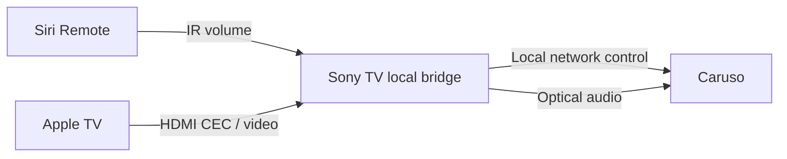

# Caruso TV Bridge

[English](README.md) · [Deutsch](README.de.md) · [Italiano](README.it.md) · [Français](README.fr.md) · [日本語](README.ja.md) · [繁體中文](README.zh-TW.md)

**Copyright (c) 2026 Adms Chung** · [Apache-2.0](LICENSE) · [引用／改寫／重製署名](docs/ATTRIBUTION.md)

**桌面版原始碼 0.5.31：**包含 Apple TV 音樂控制／資訊、USB 旋鈕靜音、同步歌詞及裝飾用 Zen 沙畫。設備與帳號資料以本機私有檔案設定，請見[桌面設定](docs/WEB.md)及[公開版本隱私邊界](docs/PUBLICATION.md)。

A local web/Electron controller and experimental Sony Android TV bridge for T+A Caruso. Keep optical audio, use Siri Remote volume buttons, and follow TV standby/wake events without a Mac running as the daily bridge.

本專案包含網頁／macOS 遙控器，以及在 Sony Android TV 本機執行的 Siri Remote 橋接。**公開版沒有預設音響 IP**；裝置資訊只在自己的環境設定。

## 功能

| 元件 | 提供的功能 | 目前限制 |
| --- | --- | --- |
| Sony TV bridge | 收到的紅外線音量 ± → Caruso；TV 待機 → Comfort 待機；Apple TV 喚醒／指定 HDMI Active Source → 開機與光纖 | 依賴 TV 本機 ADB、特定 IR/CEC 行為；不同型號需驗證 |
| Web / Electron | LUCI 媒體狀態、音量與播放控制；唯讀音場設定頁 | 尚未讀取完整音場設定；完整備份／還原保持鎖定 |

播放／暫停保留 Apple TV 原功能。參考裝置無法在 Sony 端觀察 Siri Remote 的播放鍵，所以光纖跟隨喚醒／HDMI Active Source。切換電視輸入是否會產生該 CEC 訊號，依设备而異。

音量刻度不同：TV bridge 使用 MCU 原生 0–63；Web 使用 LUCI 0–100。兩者不能直接當成相同的格數。

## Web / Electron 快速開始

需要 Node.js 22+。以下 `10.0.0.123` 是範例，必須替換成自己的 Caruso IP：

```sh
cd web
CARUSO_HOST=10.0.0.123 npm start
# Browser: http://127.0.0.1:43186
```

Web 服務只監聽本機 loopback；不是公開網站，也不提供網際網路遠端控制。環境變數未設定時會停止啟動，不會自動掃描或嘗試預設設備。

```sh
cd web
npm ci
CARUSO_HOST=10.0.0.123 npm run desktop
npm run package:mac
npm run sign:mac:adhoc
```

打包結果位於 `web/dist/`，目標為 **Apple Silicon macOS（arm64）**。上述命令使用本機 ad-hoc 簽章。Developer ID 簽署請設定自己的 `CARUSO_MAC_SIGN_IDENTITY` 再執行 `npm run sign:mac`；公證是另一步驟。可使用 `CARUSO_HOST` 或本機私有的 `devices.json` 啟動，詳見 [Web / macOS 設定](docs/WEB.md)。

## Sony Android TV

閱讀 [Android 建置與安裝](docs/ANDROID.md)。在 App 中設定 Caruso IP、Apple TV 的 HDMI 連接埠、CEC 邏輯位址、紅外線裝置路徑與名稱，再啟動橋接。第一次本機 ADB 授權必須由使用者在電視確認。

日常拓撲：



Sony TV 必須允許 `127.0.0.1:5555` 的本機 ADB 連線。這條路徑沿用 Android 正常配對授權；不需要 root，不略過系統確認。不是所有 Android TV 或韌體都提供相同行為。

## 驗證範圍

基礎版本曾在單一 Sony Android TV／Caruso 組合上完成實體遙控器音量與電源測試，且 Mac ADB 在操作期間斷開。**公開 v0.3.0 新增可設定裝置欄位，經模擬測試與 APK 建置；沒有宣稱已在所有裝置上實測。**

來源已是光纖時不重送選擇指令；從其他來源實際切回光纖、完整電視重新開機後自動啟動，仍需自己的設備驗證。[完整驗證與限制](docs/VALIDATION.md)。

不提供 EQ、音場、擺位 setter。匯出的 observation 是狀態觀察，不是可還原的設定備份。

## 開發

```sh
node --test web/test/*.test.mjs
python3 scripts/test_bridge.py
python3 -m unittest discover -s scripts/tests
python3 scripts/check_public_tree.py --history
```

測試使用本機模擬服務，不需音響。Android 編譯需要 JDK 17+、Python 3.9+ 與 Android SDK，見 `docs/ANDROID.md`。CI 會跑測試、來源去敏化檢查與 unsigned APK 建置，不會連接家用裝置。

## 引用、改寫與重製

除另有標示的第三方材料外，本專案的原創程式碼、腳本、文件與圖解採 **Apache License 2.0**。再散布時須附上授權文字、依條款保留仍適用的版權與 [NOTICE](NOTICE) 署名資訊；修改後再散布須在修改檔案中清楚標示變更。署名包含 **Copyright (c) 2026 Adms Chung** 與來源 https://github.com/adms/caruso-tv-bridge。

引用格式、義務範圍及舊版 MIT 授權紀錄見 [ATTRIBUTION](docs/ATTRIBUTION.md)；引用 metadata 見 [CITATION.cff](CITATION.cff)。外部貢獻的授權及提交權利說明見 [CONTRIBUTING](CONTRIBUTING.md)。NOTICE 與引用建議不增加 Apache-2.0 的條件。

第三方程式碼保留其原作者與授權，見 [THIRD_PARTY_NOTICES](THIRD_PARTY_NOTICES.md)。此為獨立相容性專案，與 T+A、Apple、Sony 無隸屬或背書關係。
